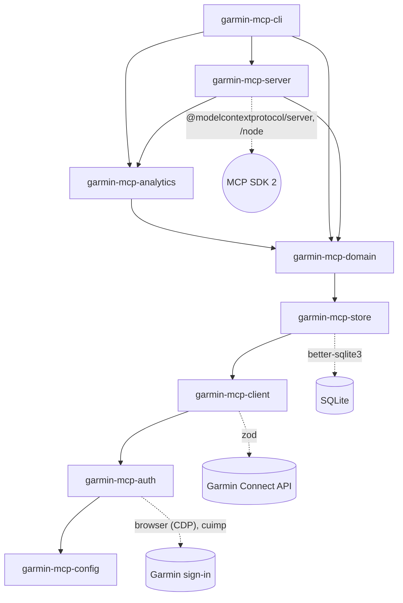

# Development

How the repository is built, tested and released. Using the server: [README.md](README.md) and the [documentation site](https://endurancetools.github.io/garmin-mcp/).

## Setup

Node.js 22+, pnpm 10 (`corepack enable` picks the pinned version from `package.json`).

```bash
pnpm install
pnpm check                                      # lint, typecheck, test, build for every project (nx run-many)
pnpm nx graph                                   # layer graph
pnpm nx test garmin-mcp-domain --skip-nx-cache  # one project, fresh
```

`better-sqlite3` installs from the prebuilt binaries shipped in its package (macOS, Linux, Windows; x64 and arm64), so no compiler is needed; it is deliberately kept out of pnpm's `onlyBuiltDependencies`. The `cuimp` (curl-impersonate) package has no install script and downloads its binary on first use, so a missing one never blocks installation.

## Layout

```
apps/mcp-server    garmin-mcp-server     MCP adapter (@modelcontextprotocol/server 2.x): tools, resources, prompts, stdio + streamable HTTP
apps/cli           garmin-mcp-cli        login, sync, previews, analytics commands, doctor, record
packages/analytics garmin-mcp-analytics  training analytics: threshold history, TSS from power, pace or HR, CTL/ATL/TSB, ACWR, readiness, CSV import
packages/domain    garmin-mcp-domain     GarminService use cases, metrics (CTL/ATL/TSB, trends), workout builder, runtime wiring
packages/store     garmin-mcp-store      SQLite (better-sqlite3, WAL), migrations, TTL rules, Syncer
packages/client    garmin-mcp-client     typed connectapi client, zod schemas, retries, pool of 4
packages/auth      garmin-mcp-auth       browser sign-in (DevTools Protocol), mobile SSO + MFA, DI OAuth2, refresh mutex, curl/fetch/import
packages/config    garmin-mcp-config     config loading, hosts, paths and permissions, logger, dates
scripts/           garmin-mcp-scripts    eval harness (see Evals), mcpb build
```



Imports only go downward (apps → analytics → domain → store → client → auth → config; `analytics` also imports `store` and `config` directly and is computed from the cache only, never from the Garmin client); the diagram shows the direct `dependencies` of each package (every package also depends on the ones below its direct ones). Both oxlint (`no-restricted-imports` per package) and `@nx/enforce-module-boundaries` (tags `scope:*`, `type:*`) fail the lint on a violation. The single exception is `garmin serve` importing `garmin-mcp-server`.

Checked on 2026-10-08 (oxlint 1.87, ESLint 10.12, Nx 23.3): a deliberate `import { GarminService } from 'garmin-mcp-domain'` in `packages/store/src` makes `pnpm nx lint garmin-mcp-store` exit 1. oxlint reports first (`no-restricted-imports`: "Layer violation: garmin-mcp-store may only import garmin-mcp-client, garmin-mcp-config"); `nx lint` stops there, because the two linters run in sequence. ESLint on its own reports the same import as `@nx/enforce-module-boundaries`: "Circular dependency between garmin-mcp-store and garmin-mcp-domain".

## Tests

Tests run without network: msw for the client against `packages/client/fixtures` (recorded from a real account with `garmin record <endpoint>`, anonymized), in-memory SQLite for the store, recorded Garmin workout JSON in `packages/domain/fixtures/workouts` for the workout builder. Live end-to-end checks are manual (`GARMIN_E2E=1`), never in CI.

The MCP server is built on `@modelcontextprotocol/server` 2.x (`serveStdio` and `createMcpHandler`, which answer both protocol eras). `apps/mcp-server/src/protocol.test.ts` starts the built `dist/main.js` over stdio and connects twice: with a `@modelcontextprotocol/sdk` 1.x client (2025 handshake) and with a `@modelcontextprotocol/client` 2.x client pinned to 2026-07-28; the server's `test` target therefore builds first. The old SDK stays in the server's `devDependencies` for that test only.

`apps/mcp-server/src/server.test.ts` also checks that `mcpb/manifest.json` lists exactly the server's tools and prompts, and that the tool list stays within its context budget (below).

CI (`.github/workflows/ci.yml`) runs `nx affected` on Ubuntu, macOS and Windows for pushes and pull requests, and `nx run-many` for a manual run. File-mode tests (0600/0700) skip on Windows, where POSIX modes do not apply; paths in tests go through `path.resolve`/`fileURLToPath` so they hold on Windows too.

## Tool-list budget

Clients send `name`, `description` and `inputSchema` of every tool to the model with each request. For the 20 default tools that is 31 214 bytes (about 7 800 tokens; 32 796 with the 3 destructive ones), of which `create_workout` takes 11 299 and the four analytics tools (`get_load`, `get_readiness`, `get_thresholds`, `set_threshold`) 5 560; shared workout schemas (`Target`, `Duration`, `Step`...) sit once per tool in `$defs` (JSON Schema 2020-12) instead of being copied into every field, and the `rules`/`flags` inputs are one open object each with the keys and defaults in its description. The whole `tools/list` including the `outputSchema` of each tool is 68 452 bytes (72 175). A test in `apps/mcp-server/src/server.test.ts` keeps these under 32 214 / 33 796 / 11 500 and 69 452 / 73 175 bytes (measured plus 1 000; `create_workout` keeps its own limit of 11 500); when a description grows, measure and keep the margin.

## Evals

`docs/evals/tool-selection.jsonl` holds scenarios for tool selection, in Polish and English, one per line: `{"prompt": "...", "expect": {"tool": "...", "args_include": {...}}, "forbid": ["..."]}`. `expect.tool` is `null` when no tool fits (e.g. deleting an activity while destructive tools are off), or a list of names when several first calls are right (e.g. `["create_workout", "get_thresholds", "get_training_status", "list_workouts"]` for "build me 6x400 m", with `{"create_workout": {"dry_run": true}}` in `args_include`); a tool may not be both listed and in `forbid`. `args_include` is a subset of the tool input: extra keys are fine, arrays match element by element in any order. With a list, `args_include` is either shared by all listed tools or keyed by tool name (`{"query_health": {"metrics": ["sleep"]}}`), and then checked only for a tool that has an entry.

```bash
pnpm nx build garmin-mcp-server
node scripts/eval-tools.mjs [scenarios.jsonl]
```

The eval needs a signed-in Claude Code (`claude` on `PATH`), not an API key. Each scenario is one `claude -p` call with `--output-format stream-json`, `--max-turns 1`, no built-in tools (`--tools ""`), no settings files (`--setting-sources ""`) and only one MCP server (`--strict-mcp-config`): `scripts/eval-fake-server.mjs`, the real server over stdio with a fake `GarminService` that returns empty envelopes, so nothing reaches Garmin or your cache. `claude` runs in a fresh temporary directory, so this repo's files do not reach the prompt. Only the first tool call of the first reply counts: it must be `expect.tool` (or one of the list) with `args_include`, and must not be one of `forbid`. It prints a table and the pass rate. `EVAL_MODEL` is passed as `--model` (default `sonnet`), `EVAL_MIN_PASS` sets the threshold (default `0.9`). Exit code 0 at or above the threshold, 1 below it, 2 when `claude` is not on `PATH`; the eval uses your Claude Code plan limits and is not part of `pnpm check` or CI. The scenario parser, the matcher and the `stream-json` parser have offline tests in `scripts/eval-tools.test.mjs` (Nx project `garmin-mcp-scripts`). Last run (2026-10-12, sonnet, 20 tools): 42/42; "Zrób mi trening 6x400 m" also accepts `get_thresholds` as the first read (threshold pace for the intervals), and "Ile procent czasu biegania i roweru spędziłem w tym miesiącu w Z1, poniżej LT1?" reaches `get_load` (3 of 3 reruns) since `get_period_summary` says its zones are the Garmin HR zones and points the Z1/Z2/Z3 split against LT1/LTHR to `get_load`.

## Release

Versions are fixed across all packages (`nx release`). `CHANGELOG.md` is written by hand in English for users, not generated from commits (`nx.json`: `workspaceChangelog.file` is `false`); `docs/changelog.md` is the same text for the documentation site, with front matter and a relative link to `analytics.md`. Four steps:

1. Add a `## <x.y.z> (<date>)` section to `CHANGELOG.md` and `docs/changelog.md`, commit and push. The release job fails without that section.
2. `gh workflow run CI -f version=<x.y.z>` (or a keyword such as `minor`; empty = bump from conventional commits). The `release` job versions all packages together, commits, tags `v<x.y.z>`, creates the GitHub release with the `CHANGELOG.md` section as its notes, attaches `garmin-mcp-<x.y.z>.mcpb` (`scripts/build-mcpb.sh`: the Claude Desktop extension, which runs `npx -y garmin-mcp-server@<x.y.z>`, validated with `mcpb validate`). It then tries the MCP registry, which fails until the npm version exists (step 4). Pushes and pull requests never release; the `mcpb` job only keeps the extension as a workflow artifact.
3. `git pull && pnpm install && pnpm nx run-many -t build && pnpm -r publish --access public --no-git-checks` on your machine, signed in to npm with 2FA. npm publishes new packages through a staged publish that a maintainer approves with 2FA, and granular tokens are losing direct publish, so npm is not published from CI. `pnpm publish` rewrites `workspace:*` to the released versions when it packs; `npm publish` would not. The `.mcpb` attached in step 2 works from this moment.
4. MCP registry, once the npm version exists: `gh workflow run CI -f registry_only=true` (GitHub OIDC), or locally `mcp-publisher login github --token "$(gh auth token)" && mcp-publisher publish`. The registry grants the organization namespace `io.github.endurancetools/*` only to an org owner whose role it can read, so the token must carry `read:org`; the interactive `login github` lacks that scope and only grants the personal namespace.

The server and CLI read their version from `package.json`, so `serverInfo.version` and `garmin --version` follow the release.

## Conventions

- Commit messages follow conventional commits (`feat`, `fix`, `docs`, `ci`, `chore(release)`); the version bump and changelog come from them.
- Nothing in the repository mentions the account owner's data: fixtures are anonymized, and tests never reach Garmin.
