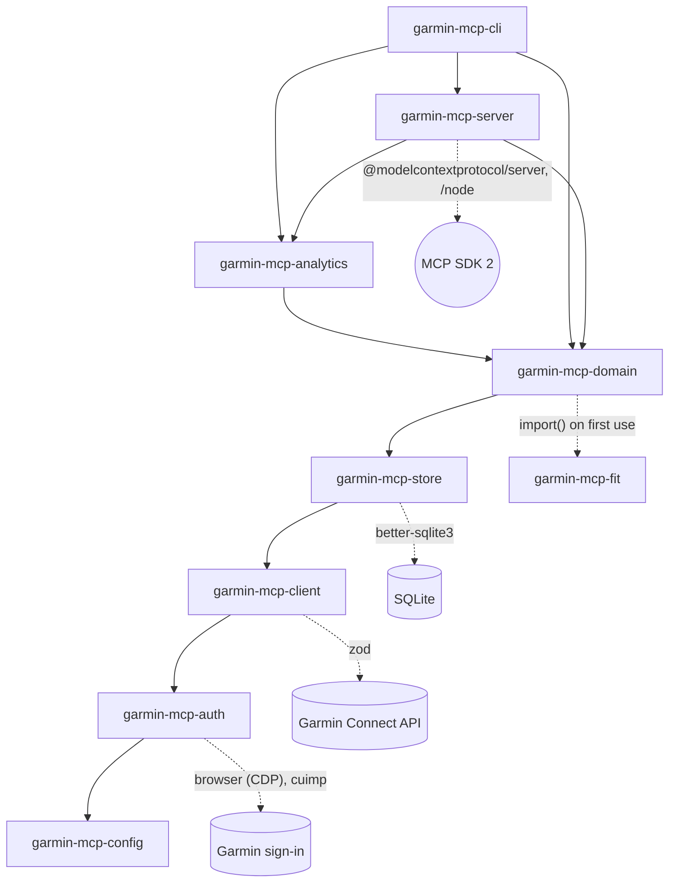

# Development

How the repository is built, tested and released. Using the server: [README.md](README.md) and the [documentation site](https://endurancetools.github.io/garmin-mcp/).

## Setup

Node.js 22+, pnpm 10 (`corepack enable` picks the pinned version from `package.json`).

```bash
pnpm install
pnpm check                                      # lint, typecheck, test, build for every project (nx run-many)
pnpm nx graph                                   # layer graph
pnpm nx test garmin-mcp-domain --skip-nx-cache  # one project, fresh
```

`better-sqlite3` installs from the prebuilt binaries shipped in its package (macOS, Linux, Windows; x64 and arm64), so no compiler is needed; it is deliberately kept out of pnpm's `onlyBuiltDependencies`. The `cuimp` (curl-impersonate) package has no install script and downloads its binary on first use, so a missing one never blocks installation.

## Layout

```
apps/mcp-server    garmin-mcp-server     MCP adapter (@modelcontextprotocol/server 2.x): tools, resources, prompts, stdio + streamable HTTP
apps/cli           garmin-mcp-cli        login, sync, previews, analytics commands, doctor, record
packages/analytics garmin-mcp-analytics  training analytics: threshold history, TSS from power, pace or HR, CTL/ATL/TSB, ACWR, readiness, CSV import
packages/domain    garmin-mcp-domain     GarminService use cases, metrics (CTL/ATL/TSB, trends), workout builder, runtime wiring
packages/fit       garmin-mcp-fit        FIT files: reader (fit-file-parser) for 1 Hz records and gear shifts, encoder for weight scale files; no other garmin-mcp package
packages/store     garmin-mcp-store      SQLite (better-sqlite3, WAL), migrations, TTL rules, Syncer
packages/client    garmin-mcp-client     typed connectapi client, zod schemas, retries, pool of 4
packages/auth      garmin-mcp-auth       browser sign-in (DevTools Protocol), mobile SSO + MFA, DI OAuth2, refresh mutex, curl/fetch/import
packages/config    garmin-mcp-config     config loading, hosts, paths and permissions, logger, dates
scripts/           garmin-mcp-scripts    eval harness (see Evals), mcpb build
```



Imports only go downward (apps → analytics → domain → store → client → auth → config; `analytics` also imports `store` and `config` directly and is computed from the cache only, never from the Garmin client; `fit` imports no other package and `domain` loads it with a dynamic `import()` in `packages/domain/src/fit.ts` only, so starting the server never loads the FIT parser, which `apps/mcp-server/src/lazy-fit.test.ts` checks); the diagram shows the direct `dependencies` of each package (every package also depends on the ones below its direct ones). Both oxlint (`no-restricted-imports` per package) and `@nx/enforce-module-boundaries` (tags `scope:*`, `type:*`) fail the lint on a violation. The single exception is `garmin serve` importing `garmin-mcp-server`.

Checked on 2026-10-08 (oxlint 1.87, ESLint 10.12, Nx 23.3): a deliberate `import { GarminService } from 'garmin-mcp-domain'` in `packages/store/src` makes `pnpm nx lint garmin-mcp-store` exit 1. oxlint reports first (`no-restricted-imports`: "Layer violation: garmin-mcp-store may only import garmin-mcp-client, garmin-mcp-config"); `nx lint` stops there, because the two linters run in sequence. ESLint on its own reports the same import as `@nx/enforce-module-boundaries`: "Circular dependency between garmin-mcp-store and garmin-mcp-domain".

## Tests

Tests run without network: msw for the client against `packages/client/fixtures` (recorded from a real account with `garmin record <endpoint>`, anonymized), in-memory SQLite for the store, recorded Garmin workout JSON in `packages/domain/fixtures/workouts` for the workout builder. FIT files in tests are synthetic, built in the test from the message builders in `packages/fit/src/test-utils/encode.ts` and the encoder of `garmin-mcp-fit` (`packages/fit/src/encode.ts`); no recorded activity file is committed. Live end-to-end checks are manual (`GARMIN_E2E=1`), never in CI.

`garmin record` anonymizes before writing (`anonymize` in `apps/cli/src/record.ts`): names, free text, profile ids, device serials and coordinates as before, and the ids of the account's objects (activities, workouts and steps, devices, gear, courses, calendar items, badges, plans, records, weigh-ins) by key pattern, so responses of any shape are covered. An id becomes a fake of the same format (digit count, UUID shape), the HMAC of the value under a random salt that the first recording writes to `record-salt` in the data directory (0600, never in the repository): every recording on the same machine gives a real id the same fake, so fixtures stay linked to each other, and without the salt the real id cannot be recovered. Dictionary ids (`activityTypeId`, `typeId`, categories, statuses, units...) stay; the list is in the comment of `DICTIONARY_ID` and in `cli.test.ts`. Gear names the owner gave become `anon-…`, body measurements (weight, height, body fat, water, bone and muscle mass, BMI, metabolic age) and the profile's FTP, lactate threshold and VO2max become neutral constants in the same unit, and the power zone floors of `power-zones` are scaled to that neutral FTP (`floor * 200 / FTP`, rounded; a zero floor stays), so the real FTP cannot be read back from them; the power zone boundaries of an activity (`activity-power-zones`, which has no FTP) are scaled by one factor so that the lowest non-zero one is 100 W (`b * 100 / lowest`, rounded; zeros and time in zone stay, `activity-hr-zones` stays); time series (heart rate, sleep, HRV, stress) and heart rate zones stay. After writing, the command lists the keys where text is left, to review before committing.

The MCP server is built on `@modelcontextprotocol/server` 2.x (`serveStdio` and `createMcpHandler`, which answer both protocol eras). `apps/mcp-server/src/protocol.test.ts` starts the built `dist/main.js` over stdio and connects twice: with a `@modelcontextprotocol/sdk` 1.x client (2025 handshake) and with a `@modelcontextprotocol/client` 2.x client pinned to 2026-07-28; the server's `test` target therefore builds first. The old SDK stays in the server's `devDependencies` for that test only.

`apps/mcp-server/src/server.test.ts` also checks that `mcpb/manifest.json` lists exactly the server's tools and prompts, and that the tool list stays within its context budget (below).

CI (`.github/workflows/ci.yml`) runs `nx affected` on Ubuntu, macOS and Windows for pushes and pull requests, and `nx run-many` for a manual run. File-mode tests (0600/0700) skip on Windows, where POSIX modes do not apply; paths in tests go through `path.resolve`/`fileURLToPath` so they hold on Windows too.

## Tool-list budget

Clients send `name`, `description` and `inputSchema` of every tool to the model with each request. For the 21 default tools that is 38 753 bytes (about 9 700 tokens; 40 739 with `GARMIN_ENABLE_DESTRUCTIVE=true`, which adds the 3 delete tools, `create_workout` `workout_id` and `update_activity` `exercise_sets`), of which the `create_workout` schema takes 11 216 and the five analytics tools (`get_load`, `compare_activities`, `get_readiness`, `get_thresholds`, `set_threshold`) 8 017; shared workout schemas (`Target`, `Duration`, `Step`...) sit once per tool in `$defs` (JSON Schema 2020-12) instead of being copied into every field, the `rules`/`flags` inputs are one open object each with the keys and defaults in its description, and input schemas carry no `$schema` key (`withoutDialect` in `server.ts`; MCP reads a schema without it as JSON Schema 2020-12, and the key would cost 57 bytes per tool). The whole `tools/list` including the `outputSchema` of each tool is 91 002 bytes (95 128). A test in `apps/mcp-server/src/server.test.ts` keeps these under 39 753 / 41 739 / 11 500 and 91 588 / 95 714 bytes (the part the model reads: measured plus 1 000; `create_workout` keeps its own limit of 11 500); when a description grows, measure and keep the margin.

New data goes where it costs the model least, in this order: new fields in the answer of a tool that already answers the question (0 bytes of context), a new value of an existing enum (`detail`, `bucket`, `granularity`, `metrics`), a new optional input field, and only then outside the tool list, as a resource (`garmin://...`), a prompt or a CLI command, none of which the model reads with every request. The tool count stays at 21: the hourly health data, typed splits, climbs, power curve, threshold history, sleep timeline, training plan, hydration, solar input, privacy and manual activities all went into existing tools for 1 540 bytes, courses, badges and `garmin://today` into resources.

New data also costs requests to Garmin. A download that a question triggers outside a sync job goes through `Syncer.lazyRequest` or `Syncer.ensureIntraday`, so it counts toward the daily request counter (`sync:requests:<day>`, capped by `GARMIN_SYNC_MAX_REQUESTS_PER_DAY`) and is not sent at the cap or while syncing is paused after a 429 or a Cloudflare challenge: the FIT file of a power curve, the hourly series, hydration, the training plan, the threshold history, courses, badges and solar input. The one exception is the `get_activity` sections fetched by `GarminService.#detail` (`summary`, `splits`, `typed_splits`, `split_summaries`, `hr_zones`, `power_zones`, `weather`, `exercise_sets` and the `details` stream): one request per section and activity, stored in the cache for good, outside the counter, the cap and the pause. Writes (`update_activity`, `garmin log`, `garmin upload`), `download_activity_file` and `garmin course download` are not counted either.

## Evals

`docs/evals/tool-selection.jsonl` holds scenarios for tool selection, in Polish and English, one per line: `{"prompt": "...", "expect": {"tool": "...", "args_include": {...}}, "forbid": ["..."]}`. `expect.tool` is `null` when no tool fits (e.g. deleting an activity while destructive tools are off), or a list of names when several first calls are right (e.g. `["create_workout", "get_thresholds", "get_training_status", "list_workouts"]` for "build me 6x400 m", with `{"create_workout": {"dry_run": true}}` in `args_include`); `null` in the list also accepts a reply without any tool call (e.g. `[null, "get_activity"]` with `"forbid": ["update_activity"]` for fixing exercise sets while destructive tools are off: answering straight away or reading the sets first are both fine, the write is not); a tool may not be both listed and in `forbid`. `args_include` is a subset of the tool input: extra keys are fine, arrays match element by element in any order. With a list, `args_include` is either shared by all listed tools or keyed by tool name (`{"query_health": {"metrics": ["sleep"]}}`), and then checked only for a tool that has an entry.

```bash
pnpm nx build garmin-mcp-server
node scripts/eval-tools.mjs [scenarios.jsonl]
```

The eval needs a signed-in Claude Code (`claude` on `PATH`), not an API key. Each scenario is one `claude -p` call with `--output-format stream-json`, `--max-turns 1`, no built-in tools (`--tools ""`), no settings files (`--setting-sources ""`) and only one MCP server (`--strict-mcp-config`): `scripts/eval-fake-server.mjs`, the real server over stdio with a fake `GarminService` that returns empty envelopes, so nothing reaches Garmin or your cache. `claude` runs in a fresh temporary directory, so this repo's files do not reach the prompt. Only the first tool call of the first reply counts: it must be `expect.tool` (or one of the list, or no call when the list has `null`) with `args_include`, and must not be one of `forbid`. It prints a table and the pass rate. `EVAL_MODEL` is passed as `--model` (default `sonnet`), `EVAL_MIN_PASS` sets the threshold (default `0.9`). Exit code 0 at or above the threshold, 1 below it, 2 when `claude` is not on `PATH`; the eval uses your Claude Code plan limits and is not part of `pnpm check` or CI. The scenario parser, the matcher and the `stream-json` parser have offline tests in `scripts/eval-tools.test.mjs` (Nx project `garmin-mcp-scripts`). The file holds 96 scenarios. Last full run (2026-11-18, sonnet, 21 tools, 94 scenarios): 94/94; the two scenarios added after it (`privacy: "groups"`, Polish and English) passed in a run of their own, 2/2. In that run "Zrób mi trening 6x400 m" also accepted `get_thresholds` as the first read (threshold pace for the intervals), and "Ile procent czasu biegania i roweru spędziłem w tym miesiącu w Z1, poniżej LT1?" reached `get_load` since `get_period_summary` says its zones are the Garmin HR zones and points the Z1/Z2/Z3 split against LT1/LTHR to `get_load`.

## Brand images

The link preview, GitHub social preview, favicons and the Product Hunt thumbnail are SVG sources in `docs/assets/src/` and PNGs in `docs/assets/images/`, both committed:

| Source | Output | Size |
| --- | --- | --- |
| `og.svg` | `og.png` (default `og:image` of the site) | 1200 × 630 |
| `social-preview.svg` | `social-preview.png` (uploaded by hand in GitHub Settings → Social preview) | 1280 × 640 |
| `favicon.svg` | `favicon.svg` (copy), `favicon-32.png` | 32 × 32 |
| `app-icon.svg` | `apple-touch-icon.png`, `ph-thumbnail.png` | 180 × 180, 240 × 240 |

After changing a source, run `node scripts/brand-images.mjs`. It draws each SVG at its target size in headless Chrome (`CHROME` overrides the binary; otherwise the usual macOS and Linux locations), reads the size back from the PNG header and exits 1 when a PNG has the wrong size or reaches 300 kB. Text is set in Helvetica Neue / Helvetica / Arial, so another machine may render it slightly differently. The chart in the previews is a synthetic fitness/fatigue curve, not anybody's data; no Garmin logo or artwork goes into these images.

## Release

Versions are fixed across all packages (`nx release`). `CHANGELOG.md` is written by hand in English for users, not generated from commits (`nx.json`: `workspaceChangelog.file` is `false`); `docs/changelog.md` is the same text for the documentation site, with front matter and a relative link to `analytics.md`. New entries go under `## Unreleased` in both files.

`pnpm release <x.y.z|patch|minor|major>` (`scripts/release.sh`) releases from your machine, on `main` in sync with `origin/main`, with a clean tree and `gh` signed in with `read:org`. `--dry-run` runs the checks only. The steps:

1. Checks: the version is above the current one, both changelogs have a filled `## Unreleased` (or `## <x.y.z>`) section, the CI run of `HEAD` passed (the script waits while it runs) and npm is signed in (`npm login --auth-type=web` otherwise), so nothing is tagged when a later step cannot work.
2. `## Unreleased` becomes `## <x.y.z> (<date>)` in both changelogs, `server.json` takes the version (the MCP registry entry points to that npm version), committed as `chore(release): prepare <x.y.z>`.
3. `nx release <x.y.z> --skip-publish` builds, bumps every package, commits `chore(release): publish <x.y.z>`, tags `v<x.y.z>`, pushes and creates the GitHub release.
4. The `CHANGELOG.md` section replaces the notes nx wrote, and `garmin-mcp-<x.y.z>.mcpb` (`scripts/build-mcpb.sh`: the Claude Desktop extension, which runs `npx -y garmin-mcp-server@<x.y.z>`, validated with `mcpb validate`) is attached, together with the same file as `garmin-mcp.mcpb`, which `releases/latest/download/garmin-mcp.mcpb` always serves.
5. `pnpm -r publish --access public --no-git-checks` for the packages not yet on npm at that version, then waits until npm shows all of them. npm publishes new packages through a staged publish that a maintainer approves with 2FA, and granular tokens are losing direct publish, so npm is not published from CI. `pnpm publish` rewrites `workspace:*` to the released versions when it packs; `npm publish` would not. The `.mcpb` works from this moment.
6. MCP registry: `mcp-publisher` (pinned version and SHA-256, cached in `node_modules/.cache`) signs in with `gh auth token` and publishes `server.json`. The registry grants the organization namespace `io.github.endurancetools/*` only to an org owner whose role it can read, so the token must carry `read:org`; the interactive `login github` lacks that scope and only grants the personal namespace.

Each step checks whether it is already done (tag, npm versions, registry entry), so after a failure `pnpm release <x.y.z>` with the same exact version continues from where it stopped. CI never releases: the `mcpb` job only keeps the extension as a workflow artifact.

The server and CLI read their version from `package.json`, so `serverInfo.version` and `garmin --version` follow the release.

## Conventions

- Commit messages follow conventional commits (`feat`, `fix`, `docs`, `ci`, `chore(release)`); the version bump and changelog come from them.
- Nothing in the repository mentions the account owner's data: fixtures are anonymized, and tests never reach Garmin.
