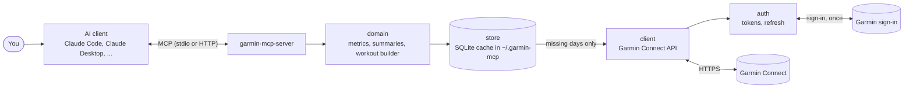
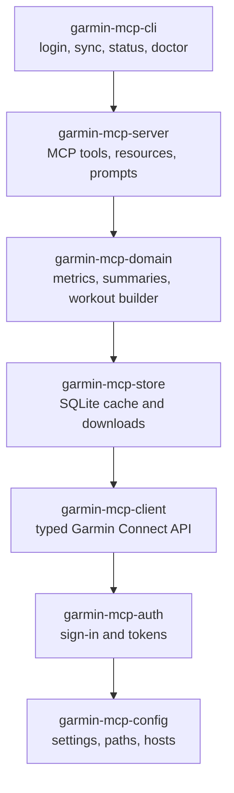

Everything runs on your machine. Your AI client starts the server, the server keeps a local database of what it has downloaded from Garmin Connect, and only the answers go to the client.

## The flow of a question

1. The client sends your question's tool call (for example "sleep from Monday to Sunday") to the server.
2. The domain layer works out which days it needs and asks the store.
3. The store answers from the local database. Days that are not there yet are downloaded from Garmin Connect, in small chunks and with pauses, and saved; later questions about the same days never hit Garmin again.
4. The domain layer turns the raw data into a dense answer (averages, trends, zones, readable workout steps) and the server returns it to the client.

Sign-in happens once, in your browser on Garmin's page; afterwards the auth layer refreshes tokens by itself.

## The packages

The server is published as seven small npm packages. You only ever install two of them, the rest come along as dependencies.

| Package | What it does |
| --- | --- |
| `garmin-mcp-server` | The MCP server your client starts: 17 tools, resources such as your profile and gear, two prompts; stdio and streamable HTTP. Built on the official MCP SDK. |
| `garmin-mcp-cli` | The `garmin` command for setup and checks: `login`, `status`, `sync`, `doctor`, `logout`, plus `activities` and `health` for a quick look from the terminal. |
| `garmin-mcp-domain` | Turns stored data into answers: training load (CTL/ATL/TSB), trends, period summaries, readable workouts, and the workout builder with its presets. |
| `garmin-mcp-store` | The local SQLite database and the download logic: what is already stored, what is missing, how long cached items stay fresh, pacing and the daily request budget. |
| `garmin-mcp-client` | A typed client for Garmin Connect's API with validation of every response, retries and rate limits. |
| `garmin-mcp-auth` | Signing in (browser, terminal or imported tokens), token storage and automatic refresh. |
| `garmin-mcp-config` | Settings from environment and `config.json`, file locations and permissions, Garmin hosts per region. |

Each layer only knows the ones below it, which is why the same core powers both the server and the CLI, and why nothing in the server itself talks to Garmin directly.

## What is stored where

| Where | What |
| --- | --- |
| `~/.garmin-mcp/tokens.json`, `account.json` | Garmin tokens and the signed-in account; readable only by you |
| `~/.garmin-mcp/garmin-<account>.db` | the local database (one per account): activities, daily health, sleep, training status, workouts, calendar, gear, devices |
| `~/.garmin-mcp/downloads/` | activity files you asked to download (FIT, GPX, ...) |
| `~/.garmin-mcp/config.json` | optional settings |

Delete the folder to remove everything; sign in again to start over.
