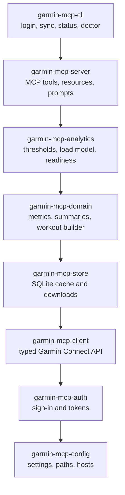

Everything runs on your machine. Your AI client starts the server, the server keeps a local database of what it has downloaded from Garmin Connect, and only the answers go to the client.

## The flow of a question

1. The client sends your question's tool call (for example "sleep from Monday to Sunday") to the server.
2. The domain layer works out which days it needs and asks the store.
3. The store answers from the local database. Days that are not there yet are downloaded from Garmin Connect, in small chunks and with pauses, and saved; later questions about the same days never hit Garmin again.
4. The domain layer turns the raw data into a dense answer (averages, trends, zones, readable workout steps) and the server returns it to the client.

Sign-in happens once, in your browser on Garmin's page; afterwards the auth layer refreshes tokens by itself.

## Designed tools, not an API mirror {#designed-tools}

A thin API wrapper hands the model one tool per Garmin Connect endpoint and leaves it to stitch the raw JSON together: several calls for one question, each filling the conversation with fields nobody asked about. Garmin Connect has well over a hundred kinds of data (the [coverage map](coverage.md) tracks them), so a one-to-one mirror would be a long tool list the model has to read before every answer.

This server starts from the questions athletes ask instead, and has {{ site.data.facts.tools_default }} tools shaped around them.

- **One call per question.** "Review my week" is one `get_period_summary`; "Can I train hard today?" is one `get_readiness`, which already weighs HRV, resting heart rate, sleep and load against your own baselines; "how did I sleep and recover this month" is one `query_health` with several metrics. The server does the downloading, joining and arithmetic, and returns a dense answer (averages, trends, zones, readable workout steps) instead of raw responses.
- **A small context budget.** Clients send every tool's name, description and input schema to the model with each message. For the {{ site.data.facts.tools_default }} default tools that is about {{ site.data.facts.tool_tokens }} tokens, and a test keeps it under a fixed limit, so a longer description has to earn its place.
- **Checked tool choice.** An evaluation sends {{ site.data.facts.eval_total }} questions in English and Polish to Claude with only this server connected and checks the first tool it picks and its key arguments; the last run passed {{ site.data.facts.eval_pass }} of {{ site.data.facts.eval_total }}. The scenarios are in [`docs/evals/tool-selection.jsonl`](https://github.com/endurancetools/garmin-mcp/blob/main/docs/evals/tool-selection.jsonl).
- **Structured output.** Every answer is JSON text and the same data as `structuredContent`, typed by the tool's output schema, with `meta.source` saying whether it came from the cache, from Garmin or was computed locally. The analytics answers also return the thresholds and rules they used, with methods from {{ site.data.facts.references }} cited references ([Methods and evidence](methods.md)).
- **Resources and prompts, not only tools.** Your profile, gear, devices, activity types and sync status are resources the client can read without a tool call, and `weekly_review` and `plan_next_week` are ready-made prompts. An explicit `garmin_sync` reports progress while it downloads.
- **Careful writes.** `create_workout` with `dry_run: true` shows the steps and estimated duration without saving anything or contacting Garmin; the assistant is told to save only after you agree. The {{ site.data.facts.tools_destructive }} tools that delete things are off unless you set `GARMIN_ENABLE_DESTRUCTIVE=true` ([Configuration](configuration.md)), and are marked as destructive, so a client that honours the hint can ask before running them.

## The packages

The server is published as eight small npm packages. You only ever install two of them, the rest come along as dependencies.

| Package | What it does |
| --- | --- |
| `garmin-mcp-server` | The MCP server your client starts: {{ site.data.facts.tools_default }} tools, resources such as your profile and gear, two prompts; stdio and streamable HTTP. Built on the official MCP SDK. |
| `garmin-mcp-cli` | The `garmin` command for setup and checks: `login`, `status`, `sync`, `doctor`, `logout`, plus `activities` and `health` for a quick look from the terminal, and the analytics commands `load`, `readiness`, `thresholds` and `import-activities` (see [Training analytics](analytics.md)). |
| `garmin-mcp-analytics` | Training analytics computed from the local cache: training thresholds with their history, its own load model (TSS from power, pace, heart rate or RPE, CTL/ATL/TSB, ACWR in `get_load`; separate from `garmin_load_model`, the same averages on Garmin's training load), the readiness of the day, and the import of a Garmin Connect CSV export. Formulas and defaults: [Training analytics](analytics.md). |
| `garmin-mcp-domain` | Turns stored data into answers: `garmin_load_model` (CTL/ATL/TSB from Garmin's training load), trends, period summaries, readable workouts, and the workout builder with its presets. |
| `garmin-mcp-store` | The local SQLite database and the download logic: what is already stored, what is missing, how long cached items stay fresh, pacing and the daily request budget. |
| `garmin-mcp-client` | A typed client for Garmin Connect's API with validation of every response, retries and rate limits. |
| `garmin-mcp-auth` | Signing in (browser, terminal or imported tokens), token storage and automatic refresh. |
| `garmin-mcp-config` | Settings from environment and `config.json`, file locations and permissions, Garmin hosts per region. |

Each layer only knows the ones below it, which is why the same core powers both the server and the CLI, and why nothing in the server itself talks to Garmin directly.

## What is stored where

| Where | What |
| --- | --- |
| `~/.garmin-mcp/tokens.json`, `account.json` | Garmin tokens and the signed-in account; readable only by you |
| `~/.garmin-mcp/garmin-<account>.db` | the local database (one per account): activities, daily health, sleep, training status, workouts, calendar, gear, devices; plus the analytics' own tables: `thresholds` (threshold history) and `imported_activities` (activities imported from CSV) |
| `~/.garmin-mcp/downloads/` | activity files you asked to download (FIT, GPX, ...) |
| `~/.garmin-mcp/config.json` | optional settings |

Delete the folder to remove everything; sign in again to start over.
